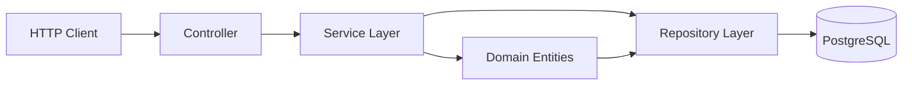
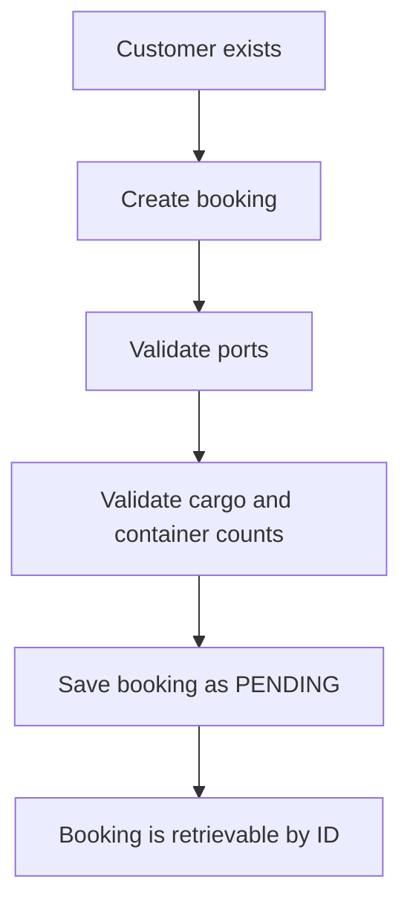
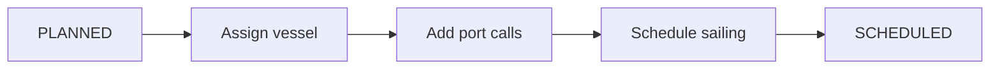

# Global Shipping Platform

## 1. Overview

Global Shipping Platform is a backend shipping management application built with Java 21 and Spring Boot. It manages core shipping operations for customers, ports, vessels, sailings, port calls, and bookings in a single application.

The project is structured as a Spring Boot monolith using Spring Data JPA and PostgreSQL for persistence. The codebase focuses on the core domain workflow: creating shipping entities, validating business rules, assigning vessels to sailings, and creating bookings between ports.

## 2. Key Features

### Customer management
- Create, read, update, and delete customer records
- Unique customer email validation
- Customer type tracking

### Port management
- Create, read, update, and delete ports
- Unique LOCODE validation
- Port name and country uniqueness checks
- Store port coordinates

### Vessel management
- Create, read, update, and delete vessels
- Unique IMO validation
- Vessel capacity and built year tracking
- Vessel status tracking

### Sailing management
- Create, read, update, and delete sailings
- Unique sailing number validation
- Assign a vessel to a sailing
- Validate scheduling before marking a sailing as scheduled

### Port calls / sailing routes
- Add port calls to a sailing
- Validate unique port-call sequence per sailing
- Enforce continuous route numbering

### Booking management
- Create bookings between origin and destination ports
- Booking status tracking
- Validation for cargo weight and container count

### Validation and exception handling
- Duplicate detection for key business entities
- Centralized error response handling
- Scheduling validation for sailings and port calls

### Concurrency handling
- Not implemented in the current codebase

## 3. Tech Stack

| Category | Technology |
|---|---|
| Language | Java 21 |
| Framework | Spring Boot 4.1.0 |
| Web layer | Spring Web MVC |
| Persistence | Spring Data JPA |
| Validation | Spring Boot Validation |
| Database | PostgreSQL |
| Build tool | Maven |
| ORM | Hibernate |
| Security | Not implemented in the current repository |
| JWT | Not implemented in the current repository |
| Lombok | Included |
| Testing | Spring Boot test starters for JPA, validation, and web MVC |
| Database driver | PostgreSQL JDBC Driver |

## 4. Architecture

This project follows a layered monolithic architecture. Requests are handled by controllers, business rules are enforced in the service layer, persistence is managed through JPA repositories, and PostgreSQL stores the application data.



Key relationships in the application:
- A `Customer` can have multiple `Booking` records
- A `Port` can participate in many bookings and port calls
- A `Sailing` contains multiple `PortCall` entries
- A `Sailing` may be assigned to a single `Vessel`
- A `Booking` links one customer to one origin port and one destination port

## 5. Project Structure

```text
global-shipping-platform/
├── .mvn/
├── src/
│   ├── main/
│   │   ├── java/com/MNS/global_shipping_platform/
│   │   │   ├── booking/
│   │   │   │   ├── controller/
│   │   │   │   ├── dto/
│   │   │   │   ├── entity/
│   │   │   │   ├── repository/
│   │   │   │   ├── service/
│   │   │   │   └── BookingStatus.java
│   │   │   ├── customer/
│   │   │   │   ├── controller/
│   │   │   │   ├── dto/
│   │   │   │   ├── entity/
│   │   │   │   ├── repository/
│   │   │   │   ├── service/
│   │   │   │   ├── CustomerType.java
│   │   │   │   ├── CustomerAlreadyExistsException.java
│   │   │   │   └── CustomerNotFoundException.java
│   │   │   ├── exception/
│   │   │   │   ├── ErrorResponse.java
│   │   │   │   └── GlobalExceptionHandler.java
│   │   │   ├── port/
│   │   │   │   ├── controller/
│   │   │   │   ├── dto/
│   │   │   │   ├── entity/
│   │   │   │   ├── repository/
│   │   │   │   ├── service/
│   │   │   │   ├── PortStatus.java
│   │   │   │   └── ...
│   │   │   ├── sailing/
│   │   │   │   ├── controller/
│   │   │   │   ├── dto/
│   │   │   │   ├── entity/
│   │   │   │   ├── repository/
│   │   │   │   ├── service/
│   │   │   │   └── SailingStatus.java
│   │   │   ├── vessel/
│   │   │   │   ├── controller/
│   │   │   │   ├── dto/
│   │   │   │   ├── entity/
│   │   │   │   ├── repository/
│   │   │   │   ├── service/
│   │   │   │   └── VesselStatus.java
│   │   │   └── GlobalShippingPlatformApplication.java
│   │   └── resources/
│   │       └── application.yaml
│   └── test/
│       └── java/com/MNS/global_shipping_platform/
│           └── GlobalShippingPlatformApplicationTests.java
├── pom.xml
├── mvnw
├── mvnw.cmd
├── README.md
├── .gitignore
├── .gitattributes
└── LICENSE (not present)
```

### Package responsibilities
- `booking`: booking entity, DTOs, repository, and service logic
- `customer`: customer registration and profile management
- `port`: port registry and metadata
- `sailing`: sailing lifecycle and route planning via port calls
- `vessel`: vessel registration and status
- `exception`: central exception handling and standard error payloads

## 6. Domain Model

### Customer
`Customer` stores:
- company name
- contact person names
- email
- phone number
- customer type
- created and updated timestamps

Business constraints:
- unique email address
- email validation through Jakarta validation

### Port
`Port` stores:
- LOCODE
- port name
- city
- country
- status
- latitude
- longitude

Business constraints:
- unique LOCODE
- unique port name + country in service validation

### Vessel
`Vessel` stores:
- IMO number
- vessel name
- capacity in TEU
- built year
- status
- created and updated timestamps

Business constraints:
- unique IMO number

### Sailing
`Sailing` stores:
- unique sailing number
- departure time
- arrival time
- sailing status
- optional vessel reference
- created and updated timestamps

Available status values:
- `PLANNED`
- `SCHEDULED`
- `IN_PROGRESS`
- `COMPLETED`
- `CANCELLED`

### PortCall
`PortCall` stores:
- associated sailing
- associated port
- sequence number
- arrival time
- departure time

Business constraints:
- unique sequence number per sailing
- continuous sequence numbering is required before scheduling

### Booking
`Booking` stores:
- customer
- origin port
- destination port
- cargo type
- cargo weight
- number of containers
- status
- created and updated timestamps

Available status values:
- `PENDING`
- `CONFIRMED`
- `IN_TRANSIT`
- `DELIVERED`
- `CANCELLED`

### User
No `User` entity is present in this repository, so there is no authentication domain model or role-based user system.

## 7. Business Rules

### Booking validation
The code prevents:
- origin and destination ports from being the same
- negative or zero cargo weight
- zero or negative container counts
- booking records for missing customer or port references

### Sailing validation
The code prevents:
- duplicate sailing numbers
- arrival time earlier than or equal to departure time
- scheduling before vessel assignment
- scheduling with a vessel that is not `AVAILABLE`
- scheduling with fewer than two port calls
- non-continuous port-call numbering

### Vessel assignment
A sailing may only be assigned a vessel while it is `PLANNED` and cannot be assigned more than one vessel.

### Port-call validation
The code prevents:
- duplicate sequence numbers within one sailing
- invalid port-call dates when departure is not after arrival
- invalid route ordering

### Booking → sailing assignment
Not implemented.

### Container → booking assignment
Not implemented.

### Capacity / weight validation
The current repository validates booking weight and container count, but it does not enforce a shipping capacity model against vessel capacity or container capacity.

### Optimistic locking
Not implemented. There is no `@Version` field in the JPA entities.

## 8. Authentication & Authorization

This repository does not currently implement authentication or authorization.

Confirmed by the codebase:
- no `SecurityConfig`
- no `JwtAuthFilter`
- no `JwtService`
- no `User` entity
- no `UserRole`
- no `UserDetailsService`
- no `AuthController`
- no `AuthService`
- no JWT dependency in `pom.xml`

All controllers are currently exposed without a security layer or role-based restrictions.

## 9. Booking Workflow

The current booking workflow is minimal and follows the validation and creation logic in `BookingService`.



Actual behavior:
- customer is read by ID
- origin and destination ports are loaded
- origin and destination cannot be the same
- cargo weight and container count must be positive
- a `Booking` is saved with status `PENDING`

The repository does not implement:
- booking approval flow
- sailing assignment to a booking
- container assignment
- transit and delivery workflow

## 10. Sailing Workflow

The main sailing workflow in the codebase is:



Actual rules enforced by `SailingService`:
- `createSailing()` creates a sailing in `PLANNED`
- `assignSailingToVessel()` only works while the sailing is `PLANNED`
- `scheduleSailing()` only works while the sailing is `PLANNED`
- scheduling requires:
  - vessel assigned
  - vessel status is `AVAILABLE`
  - at least two port calls
  - continuous sequence numbers starting at 1
- after validation, status becomes `SCHEDULED`

The code does not implement:
- `IN_PROGRESS` transitions
- `COMPLETED` transitions
- `CANCELLED` transitions

## 11. Container Workflow

No container workflow is implemented in the current repository.

The project does not contain:
- `Container` entity
- `ContainerService`
- `ContainerController`
- `ContainerStatus`
- container assignment to booking
- container loading or delivery lifecycle

This should be treated as future work, not existing functionality.

## 12. API Endpoints

| Method | Endpoint | Purpose | Required role |
|---|---|---|---|
| POST | `/api/v1/customers` | Create a customer | None |
| GET | `/api/v1/customers/{id}` | Get customer by ID | None |
| GET | `/api/v1/customers` | Get all customers | None |
| PUT | `/api/v1/customers/{id}` | Update customer | None |
| DELETE | `/api/v1/customers/{id}` | Delete customer | None |
| POST | `/api/v1/ports` | Create a port | None |
| GET | `/api/v1/ports/{portId}` | Get port by ID | None |
| GET | `/api/v1/ports` | Get all ports | None |
| PUT | `/api/v1/ports/{portId}` | Update port | None |
| DELETE | `/api/v1/ports/{portId}` | Delete port | None |
| POST | `/api/v1/vessels` | Create a vessel | None |
| GET | `/api/v1/vessels/{id}` | Get vessel by ID | None |
| GET | `/api/v1/vessels` | Get all vessels | None |
| PUT | `/api/v1/vessels/{id}` | Update vessel | None |
| DELETE | `/api/v1/vessels/{id}` | Delete vessel | None |
| POST | `/api/v1/sailings` | Create a sailing | None |
| GET | `/api/v1/sailings/{id}` | Get sailing by ID | None |
| GET | `/api/v1/sailings` | Get all sailings | None |
| PUT | `/api/v1/sailings/{id}` | Update sailing | None |
| PATCH | `/api/v1/sailings/{sailingId}/assign-vessel/{vesselId}` | Assign vessel to a sailing | None |
| PATCH | `/api/v1/sailings/{sailingId}/schedule` | Schedule a sailing | None |
| DELETE | `/api/v1/sailings/{id}` | Delete a sailing | None |
| POST | `/api/v1/port-calls` | Create a port call | None |
| GET | `/api/v1/port-calls/{sailingId}` | Get port calls for a sailing | None |
| POST | `/api/v1/bookings` | Create a booking | None |
| GET | `/api/v1/bookings/{id}` | Get booking by ID | None |

No authentication or role-based restrictions are declared in the code.

## 13. Example Requests

### Create a customer
```json
POST /api/v1/customers
{
  "companyName": "Northwind Logistics",
  "contactPersonFirstName": "Alice",
  "contactPersonLastName": "Nguyen",
  "customerEmail": "alice.nguyen@northwind.example",
  "phoneNumber": "+1-555-0101",
  "customerType": "BUSINESS"
}
```

### Create a vessel
```json
POST /api/v1/vessels
{
  "imoNumber": "9321483",
  "vesselName": "MV Horizon",
  "capacityTeu": 2200,
  "builtYear": 2018
}
```

### Create a port
```json
POST /api/v1/ports
{
  "locode": "USLAX",
  "portName": "Los Angeles",
  "city": "Los Angeles",
  "country": "United States",
  "latitude": 33.736,
  "longitude": -118.2667
}
```

### Create a sailing
```json
POST /api/v1/sailings
{
  "sailingNumber": "SAIL-2026-001",
  "departureTime": "2026-11-10T08:00:00",
  "arrivalTime": "2026-11-18T08:00:00"
}
```

### Create a port call
```json
POST /api/v1/port-calls
{
  "sailingId": "11111111-1111-1111-1111-111111111111",
  "portId": "22222222-2222-2222-2222-222222222222",
  "sequenceNumber": 1,
  "arrivalTime": "2026-11-10T10:00:00",
  "departureTime": "2026-11-11T12:00:00"
}
```

### Assign a vessel to a sailing
```http
PATCH /api/v1/sailings/11111111-1111-1111-1111-111111111111/assign-vessel/33333333-3333-3333-3333-333333333333
```

### Schedule a sailing
```http
PATCH /api/v1/sailings/11111111-1111-1111-1111-111111111111/schedule
```

### Create a booking
```json
POST /api/v1/bookings
{
  "customerId": "44444444-4444-4444-4444-444444444444",
  "originPortId": "22222222-2222-2222-2222-222222222222",
  "destinationPortId": "55555555-5555-5555-5555-555555555555",
  "cargoType": "Electronics",
  "cargoWeight": 1500,
  "numberOfContainers": 10
}
```

### Login / registration
No authentication endpoints are implemented in this repository.

## 14. Error Handling

The project uses a global exception handler through `@ControllerAdvice` in `GlobalExceptionHandler`.

Important exception mappings:
- `CustomerAlreadyExistsException` → `409 Conflict`
- `CustomerNotFoundException` → `404 Not Found`
- `PortAlreadyExistExceptions` → `409 Conflict`
- `PortNotFoundException` → `404 Not Found`
- `VesselAlreadyExistsException` → `409 Conflict`
- `VesselNotFoundException` → `404 Not Found`
- `SailingNotFoundException` → `404 Not Found`
- `SailingNumberAlreadyExists` → `409 Conflict`
- `InvalidSailingScheduleException` → `409 Conflict`

The error payload is built using `ErrorResponse` and includes:
- timestamp
- HTTP status code
- reason phrase
- exception message
- request URI

## 15. Database

The application uses PostgreSQL as its persistence layer and Spring Data JPA with Hibernate for ORM.

Current configuration in `application.yaml`:
```yaml
spring:
  datasource:
    url: jdbc:postgresql://localhost:5432/shipping_db
    username: mns666
    password:
  jpa:
    hibernate:
      ddl-auto: update
    show-sql: true
```

Database characteristics in the code:
- UUID primary keys are used across the main entities
- JPA relationships are used for customer, port, vessel, sailing, and booking associations
- unique constraints are defined for business keys such as:
  - customer email
  - port LOCODE
  - vessel IMO
  - sailing number
  - sailing port-call sequence

No migration tooling such as Flyway is present in the repository, so no migration history should be claimed.

No optimistic locking is currently implemented. There is no `@Version` field in the entity model.

## 16. Testing

The repository contains one application bootstrap test:

- `GlobalShippingPlatformApplicationTests`

This test confirms that the Spring application context loads successfully.

Current test status:
- no repository test suite
- no service tests
- no controller tests
- no integration-test suite beyond the context-load test

### Test Coverage
No formal coverage metrics are available in the repository at this time.

## 17. Configuration

The application configuration currently lives in `src/main/resources/application.yaml`.

Relevant configuration:
- application name
- PostgreSQL datasource URL
- datasource username and password
- Hibernate auto-update mode
- SQL logging

Example environment-variable overrides:
```bash
export SPRING_DATASOURCE_URL=jdbc:postgresql://localhost:5432/shipping_db
export SPRING_DATASOURCE_USERNAME=your_db_user
export SPRING_DATASOURCE_PASSWORD=your_db_password
```

The project does not currently define custom JWT or security properties because security is not implemented.

## 18. Running Locally

Prerequisites:
- Java 21
- Maven wrapper available in the project
- PostgreSQL running locally
- a database named `shipping_db` available on the local PostgreSQL instance

Run the project:
```bash
./mvnw clean install
./mvnw spring-boot:run
```

On Windows:
```powershell
mvnw.cmd clean install
mvnw.cmd spring-boot:run
```

The project uses Maven and not Gradle.

## 19. API Testing

A developer can test the application locally with Postman or curl.

Example: create a port
```bash
curl -X POST http://localhost:8080/api/v1/ports \
  -H "Content-Type: application/json" \
  -d '{
    "locode": "USLAX",
    "portName": "Los Angeles",
    "city": "Los Angeles",
    "country": "United States",
    "latitude": 33.736,
    "longitude": -118.2667
  }'
```

Example: list all sailings
```bash
curl http://localhost:8080/api/v1/sailings
```

Example: create a vessel
```bash
curl -X POST http://localhost:8080/api/v1/vessels \
  -H "Content-Type: application/json" \
  -d '{
    "imoNumber": "9321483",
    "vesselName": "MV Horizon",
    "capacityTeu": 2200,
    "builtYear": 2018
  }'
```

Example: create a booking
```bash
curl -X POST http://localhost:8080/api/v1/bookings \
  -H "Content-Type: application/json" \
  -d '{
    "customerId": "44444444-4444-4444-4444-444444444444",
    "originPortId": "22222222-2222-2222-2222-222222222222",
    "destinationPortId": "55555555-5555-5555-5555-555555555555",
    "cargoType": "Electronics",
    "cargoWeight": 1500,
    "numberOfContainers": 10
  }'
```

## 20. Project Evolution

### V1 — Core Shipping Management
The initial version contains the main shipping-domain modules:
- customer management
- port management
- vessel management
- sailing creation and scheduling logic
- port call creation and validation
- JPA persistence with PostgreSQL

### V2 — Booking & Container Workflow
The repository includes a booking module with:
- customer-based booking creation
- origin and destination port validation
- cargo and container validation
- booking status tracking

The current codebase does not include a complete container module or booking-to-container lifecycle.

### V3 — Production Readiness
The codebase includes:
- validation rules for duplicates and invalid states
- central exception handling
- business validations in the service layer
- PostgreSQL-backed persistence

However, the application does not yet include:
- JWT-based security
- role-based authorization
- full operational workflows
- optimistic locking
- a broad automated test suite

## 21. Future Improvements

The following features are reasonable next steps but are not implemented in the current repository:
- JWT authentication and authorization
- user registration and role management
- booking approval workflow
- container entity and lifecycle management
- booking-to-sailing assignment logic
- full sailing execution lifecycle (`IN_PROGRESS`, `COMPLETED`, `CANCELLED`)
- optimistic locking with `@Version`
- Flyway or database migration management
- broader automated testing coverage

## 22. License

License information has not been added yet.

---

This repository is a focused Java/Spring Boot backend for managing shipping operations. It implements the core domain model and key validation logic, but it does not yet include JWT-based authentication, role-based access control, or a complete container lifecycle.
